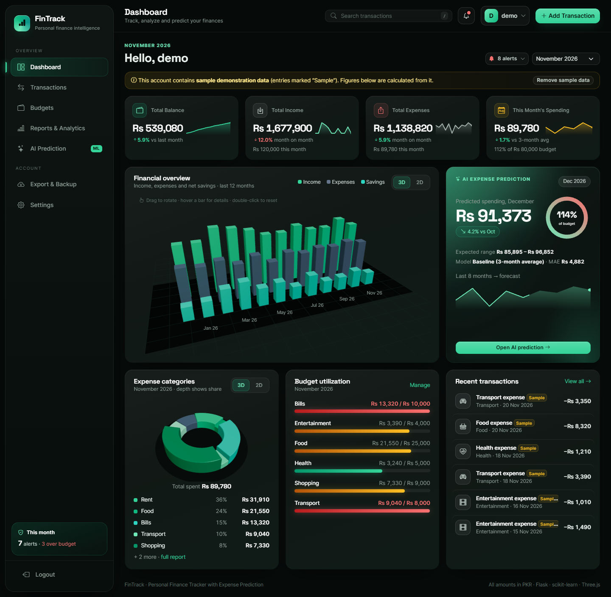

# FinTrack: Personal Finance Tracker with Expense Prediction

A premium personal-finance analytics web app built with **Python/Flask**, **scikit-learn** and **Three.js**. You record income and expenses, manage budgets, explore interactive 3D and 2D analytics, and get a **machine-learning forecast of next month's spending** that is evaluated on your own history.

> Final Year Project: *Personal Finance Tracker with Expense Prediction* (Machine Learning / Web).



---

## Run it on Windows (about 5 minutes)

**Requirements:** Python **3.10 or newer** (tested on 3.12 and 3.14) from [python.org](https://www.python.org/downloads/) (tick *"Add python.exe to PATH"* during install). The first install needs internet for `pip`. After that the app runs **fully offline**, because every frontend library is bundled.

Open **PowerShell** in the folder where you extracted the ZIP:

```powershell
cd finance-tracker
py -m venv .venv
.\.venv\Scripts\Activate.ps1
pip install -r requirements.txt
python app.py
```

Open **http://localhost:5000**, click **Create an account**, then click **Load sample data** on the dashboard to explore every feature right away.

- **No extra build or database step is needed.** The SQLite database (`instance/finance.db`) is created automatically on first start, and there is no JavaScript build step.
- **To stop the app,** press `CTRL+C`. To run it again later: `cd finance-tracker`, then `.\.venv\Scripts\Activate.ps1`, then `python app.py`.
- **If `Activate.ps1` is blocked** ("running scripts is disabled"), run this once in the same window and try again:
  ```powershell
  Set-ExecutionPolicy -Scope Process -ExecutionPolicy Bypass
  ```
- **Shortcut:** double-click **`run_windows.bat`**. It creates the virtual environment, installs the requirements the first time, and starts the app.
- **Optional checks:** `python -m unittest discover tests -v` runs the 42 automated tests, and `python migrate.py` backs up and updates an existing database.

### Troubleshooting
| Problem | Fix |
|---|---|
| `py` is not recognized | Reinstall Python with "Add to PATH" ticked, or use `python -m venv .venv` |
| `pip install` fails on numpy/scikit-learn | Use a released Python version (3.10 or newer) and upgrade pip: `python -m pip install --upgrade pip` |
| Port 5000 already in use | `$env:PORT=5050; python app.py`, then open http://localhost:5050 |
| 3D views don't appear | Your browser or graphics driver has WebGL turned off. The app switches to 2D charts automatically, so everything still works |

---

## Features

| Module | What it does |
|---|---|
| **Authentication & security** | Registration, login and logout. Passwords are hashed. Every page requires a login, and users can only see their own data. CSRF protection on every form, open-redirect-safe login, HttpOnly/SameSite cookies, secrets from environment variables, custom error pages. |
| **Dashboard** | Animated KPI tiles with 12-month sparklines. An **interactive 3D financial overview** (income, expenses and net savings by month: drag to rotate, hover for values). The AI forecast card with a budget gauge. A **3D expense-category ring** (depth shows each category's share; hover to lift a slice). Animated budget bars and recent transactions. Every 3D view has a 2D switch. |
| **Transactions** | Add, edit, view and delete (with confirmation). Categories. Search, filters (type, category, date range, amount), sorting, pagination. The add form shows a live preview of this month's totals and quick-amount buttons. |
| **Budgets** | Category budgets that repeat monthly or apply to one month only, plus an overall monthly budget. Budget vs. actual progress bars, overrun detection and alerts. |
| **Reports & Analytics** | Monthly (daily breakdown), yearly and custom date-range reports: income vs. expenses, net savings, savings rate, category breakdown, high-spending months, budget overruns, largest expenses, income sources. |
| **AI Expense Prediction** | Baseline, Linear Regression and Random Forest models compared with a chronological walk-forward test using **MAE, RMSE and MAPE**. The best model is selected automatically. An interactive timeline shows actual vs. forecast spending with an animated uncertainty band, a history range slider and past out-of-sample predictions. Model comparison cards, a backtest chart and prediction history are also included. |
| **Export & Backup** | CSV export, and Excel export (Transactions, Monthly Summary and Budgets sheets). A full JSON backup. Restore validates the whole file first, supports merge or replace, keeps a safety copy before a replace, and rolls back on error. |
| **Demo data** | One click loads 12 months of realistic sample data. It is labelled "Sample" everywhere and can be removed without touching real records. |

### Design & motion
- A dark emerald and graphite design system with layered ambient backgrounds and glass surfaces, Inter and Space Grotesk typography, and consistent styling on every page.
- **3D (Three.js):** the interactive overview bars, the category ring, and an animated "market terrain" on the sign-in page. Pixel ratio is capped and rendering pauses when a view is off-screen or the tab is hidden.
- **Motion (GSAP and CSS):** page transitions, count-up KPI values, charts that grow in, sparklines that draw themselves, animated budget bars and confidence band, animated dropdowns, and toast notifications when you save.
- **Accessibility:** every 3D view has a 2D alternative and falls back to it automatically without WebGL. *Reduced motion* is respected (animations off, static scenes). 3D canvases support keyboard rotation (arrow keys), and `/` focuses the search box.

## How the expense prediction works (`ml.py`)

1. Expenses are aggregated into **monthly totals**. The **current month is excluded** because it is incomplete.
2. Forecasting next month from the last completed month is therefore a **2-step-ahead** problem.
3. **Models (scikit-learn):**
   - *Baseline:* the average of the last 3 months.
   - *Linear Regression:* month index → total, which captures the long-term trend.
   - *Random Forest Regressor:* uses the previous 3 monthly totals as lag features and forecasts recursively.
4. **Walk-forward evaluation without data leakage:** for each of the last 4 months, every model is trained only on data available 2 months earlier. MAE, RMSE and MAPE are reported, and a unit test checks that test-period values can't influence the forecasts made for them.
5. The model with the **lowest MAE** is selected, retrained on all completed months, and its RMSE gives the ± uncertainty band.
6. **Honesty rules:** with fewer than 3 completed months, no forecast is made. With 3–8 months, a labelled low-confidence baseline is shown. Each forecast is stored and compared with the actual spending once that month ends.

## Project structure

```
finance-tracker/
├── app.py               # Flask app & routes (entry point: python app.py)
├── finance.py           # calculations: months, totals, budgets, alerts
├── ml.py                # expense prediction: models, walk-forward evaluation, forecast
├── models.py            # database models: User, Transaction, Budget, PredictionLog
├── migrate.py           # safe migration with automatic backup / rollback
├── requirements.txt     # Python dependencies
├── .env.example         # optional configuration
├── run_windows.bat      # one-click start on Windows
├── templates/           # Jinja2 pages (base layout, macros, every page)
├── public/static/
│   ├── style.css        # design system
│   ├── app.js           # charts theme, animations, toasts, sparklines, 3D/2D switch
│   ├── js/fin3d.js      # Three.js scenes (overview bars, category ring, login terrain)
│   └── vendor/          # bundled libraries: Three.js, GSAP, Plotly, Bootstrap, icons, fonts
├── tests/test_app.py    # 42 automated tests
├── screenshots/         # UI screenshots
└── Dockerfile, docker-compose.yml, render.yaml   # optional deployment files
```

**Bundled frontend libraries (no internet needed):** Three.js 0.160, GSAP 3.12, Plotly.js 2.35, Bootstrap 5.3, Bootstrap Icons 1.11, and the Inter and Space Grotesk fonts (all open-source licences).

## Database & migrations

SQLite at `instance/finance.db`, created automatically. To upgrade an older database safely:

```powershell
python migrate.py                       # backs up to instance\backups\, then adds any missing tables
python migrate.py --list                # list backups
python migrate.py --rollback instance\backups\finance-YYYYMMDD-HHMMSS.db
```

Migrations are additive only: existing users and transactions are never altered or deleted.

## Configuration

None is needed to run locally. For production, set `SECRET_KEY` to a long random value (see `.env.example`). The other options are `DATABASE_PATH`, `HOST`, `PORT` and `FLASK_DEBUG` (development only).

## Deploy on Vercel (with a free Neon PostgreSQL database)

Vercel runs `app.py` as a Python function; files in `public/` (including `public/static/`) are served from Vercel's CDN.
Vercel's filesystem is read-only and temporary, so production data is stored in **PostgreSQL** (Neon free plan).

1. Import this GitHub repository in Vercel (framework preset: Flask is detected automatically).
2. In the project's **Storage** tab, create a **Neon** database (free) and connect it; this adds `DATABASE_URL`.
3. In **Settings → Environment Variables** add `SECRET_KEY` (a long random string) and `SESSION_COOKIE_SECURE=1`.
4. Redeploy. Tables are created automatically on first start.

Locally nothing changes: without `DATABASE_URL`, FinTrack keeps using `instance/finance.db` (SQLite).

## Optional: Docker (not required for local use)

```bash
docker compose up --build -d      # http://localhost:5000, data persisted in the finance-data volume
```
The image runs Gunicorn as a non-root user with a `/health` check and contains no database or secrets.

## Known limitations

- SQLite suits a single server. Multi-instance hosting needs PostgreSQL or MySQL.
- On Render's free plan the disk is temporary, so data resets on redeploy. Use a persistent disk, or rely on backups.
- Forecasts become reliable only after about 9 months of real data, and the app says so.
- There is no email password reset (it needs an email service). Passwords can be changed in Settings.
